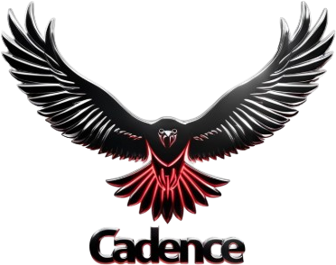

<p align="center"></p>

# Cadence

A local-first, autonomous coding agent with a web app. It runs on your own models (LM Studio, Ollama or
any OpenAI-compatible server) and is built for work that spans days, not just single prompts:

- **Projects**: named folders the agent is confined to, each with its own chats, goals, tasks, ideas,
  documents and browser.
- **Long-horizon goals**: a planner breaks objectives into verifiable tasks, runs them, learns from the
  results and keeps going until every success criterion is met.
- **A shared canvas and browser**: the agent writes documents you can edit together, and drives a real
  Chromium you can watch and take over.
- **Reads any file**: PDF, Word, PowerPoint, Excel/CSV, JSON/YAML, notebooks, databases, archives, images
  and code, as text or through the vision model.
- **Extensible from the UI**: skills, Python plugins, MCP servers and hooks, all hot-reloaded.
- **Safe by default**: sandboxed shell (bubblewrap or Docker), loopback-only web server, verify commands
  that outrank the model's opinion.

> Formerly **Kestrel**. See [Migrating from Kestrel](#migrating-from-kestrel).

## Requirements

| | |
|---|---|
| Python | 3.11+ |
| A model server | [LM Studio](https://lmstudio.ai) (default `http://127.0.0.1:1234`), Ollama, llama.cpp, vLLM… |
| Optional | Qdrant for vector memory (`deploy/docker-compose.yml`), `bubblewrap` or Docker for the sandbox, Chrome/Chromium for the shared browser, LibreOffice for legacy `.doc/.ppt/.ods`, `poppler-utils` to render document pages for the vision model |

Default model roles (change them any time in **Settings → Models**, which lists what your servers actually have):

| Role | Default | Does |
|---|---|---|
| **big** | `ornith-1.5-9b` | planning, coding, tool use, reflection, ideas |
| **small** | `liquid/lfm2-1.2b` | context compaction, project names, lesson distillation |
| **vision** | the big model | images, document pages, `browser_look` |
| **embed** | `text-embedding-nomic-embed-text-v1.5` | semantic memory |

## Quick start

```bash
pip install -e ".[browser]"         # [dev] adds the test tools
cadence doctor                      # checks models, memory, sandbox, plugins, MCP
cadence web --open                  # the web app at http://127.0.0.1:8765 (also runs the daemon)
```

Run it in the background and stop it:

```bash
setsid nohup cadence web > ~/.cadence/logs/web.log 2>&1 &
pkill -f "bin/[c]adence web"
```

The web app is the main interface. A terminal UI is there too: `cadence` (chat), `cadence daemon`,
`cadence run "add tests for parser.py" --verify "pytest -q"`.

## The web app

- **Projects**: switch from the top of the sidebar. A project is a folder: the agent's file tools, shell and
  sandbox are confined to it. Leave the name empty and the small model names it from the folder's files.
  Edit a project's description and standing instructions for the agent; **archive** projects you are done
  with (hidden, no background work, nothing deleted) and restore them any time.
- **Chat**: streaming replies, tool cards, thinking, steering (anything you send while it works redirects it),
  `Esc` to stop, and attachments of any file type. A resizable dock beside the chat holds:
  - **Plan**: the agent's task list, context meter and session health.
  - **Canvas**: documents the agent writes (plans, reports, specs, HTML mockups). Edit them yourself; the
    agent re-reads your edits before revising. Version history; save as a project file.
  - **Browser**: one real Chromium per project, streamed live. Your clicks, typing and scrolling go to the page,
    so you can log in or solve a captcha and hand back. Logins persist per project.
- **Files**: explorer and editor. Spreadsheets and CSV show as tables, PDFs in the browser's viewer, Word,
  PowerPoint and notebooks as formatted text, with audio/video players and a **Look** bar that asks the vision
  model about an image or page. Files the agent writes are marked and refresh live; saving over an agent edit
  asks first.
- **Goals**: long-horizon objectives with a vision and success criteria. The planner assesses progress (0-100%),
  queues the next 1-3 tasks, re-plans after each, asks you when it is stuck, and marks the goal achieved when
  every criterion is met. Journal, pause/resume, and notes that steer the planner.
- **Tasks**: concrete, verifiable work (act → verify → reflect → retry), from you, from ideas or from the
  planner. Edit, delete, steer, stop, retry, open the transcript.
- **Ideas**: an inbox the daemon fills on its heartbeat (or **Brainstorm** on demand). Edit, dismiss, delete, or
  promote to a task or a goal. Nothing runs until promoted, unless `auto_approve_ideas` is on.
- **Memory**: semantic search; add and forget memories.
- **Extensions**: create, edit, enable/disable and delete skills (or import a folder/URL), Python plugins
  (reloaded on save), MCP servers (or paste a Claude Desktop `mcpServers` block) and hooks (with a Test
  button). Changes reach chats that are already running.
- **Settings**: model roles from a live scan of your servers, per-model parameters, agent and daemon limits,
  sandbox, memory, browser, projects and system status. Applied immediately and kept across restarts; theme
  and active project follow you between browsers.

## Reading any file

Attach any file in chat, or let the agent find it in the project. Attachments are saved to
`.cadence/attachments/` in the project and their contents go into your message.

| Kind | Formats | Becomes |
|---|---|---|
| Documents | pdf (per page), docx, pptx, odt/odp, rtf, epub, ipynb; doc/ppt via LibreOffice | text with headings, lists, tables and speaker notes |
| Data | xlsx/xlsm, xls, ods, csv/tsv, json/jsonl/jsonld, yaml | tables with column statistics, or a structure outline |
| Code & text | anything UTF-8 (py, ts/tsx, js/jsx, css, html, xml, md, toml, sql, logs…) | line-numbered source the agent can edit |
| Containers | sqlite, zip/tar/gz | schema, row counts and samples; file listings |
| Media | images (any format), audio, video | dimensions and metadata; images and pages go to the vision model |
| Anything else | | file type, printable strings and a hex preview |

The agent's tools: `read_file` (with `pages=`, `sheet=` and `structured=true`), and `view_image` for any image
or any page of a PDF or Office document, for charts, layouts and scanned pages.

## Command line

```bash
cadence goals add "Ship v1 of the billing API" --success "POST /v1/invoices works" --success "docs/api.md exists"
cadence goals | goals show <id> | goals pause|resume|archive <id>
cadence tasks add "fix the flaky auth test" --verify "pytest -q tests/test_auth.py"
cadence ideas | ideas add "..." | ideas promote <id> | ideas dismiss <id>
cadence memory search "how do we deploy"     # also: stats | add | reindex
cadence inspect tools                        # also: skills | mcp | plugins | hooks
```

In terminal chat: `/task`, `/goal`, `/goals`, `/tasks`, `/ideas`, `/approve <id>`, `/image <path>`,
`/memory <query>`, `/help` for the rest.

## Configuration

Settings are layered, later wins:

1. built-in defaults
2. `~/.cadence/config.yaml` (start from `examples/config.yaml`)
3. `<project>/.cadence/config.yaml`
4. `~/.cadence/settings.json`, written by the web app (same keys as `config.yaml`)
5. environment variables: `LMSTUDIO_URL`, `CADENCE_BIG_MODEL`, `CADENCE_SMALL_MODEL`, `CADENCE_BIG_URL`,
   `CADENCE_SMALL_URL`, `CADENCE_SANDBOX`, `CADENCE_MEMORY_BACKEND`, `CADENCE_HOME`

Secrets in config files can be written as `$ENV_NAME` and are read from the environment.

| Path | Holds |
|---|---|
| `~/.cadence/config.yaml`, `settings.json` | your configuration |
| `~/.cadence/state/` | projects, goals, tasks, ideas, canvas, chat sessions, memory, browser profiles |
| `~/.cadence/skills/`, `~/.cadence/plugins/` | skills and plugins for all projects |
| `<project>/.cadence/` | that project's skills, plugins, config and chat attachments (add it to the project's `.gitignore`) |

## Migrating from Kestrel

The first time Cadence starts it migrates an existing Kestrel install, once:

- `~/.kestrel` moves to `~/.cadence`, and a symlink is left at the old path.
- Each project's `.kestrel/` folder becomes `.cadence/`.
- Plugin imports change from `kestrel` to `cadence`, and the original files are kept as `*.kestrel-bak`.
- `.kestrel` paths in `config.yaml`, `settings.json` and chat transcripts are updated.
- An existing Qdrant collection (`kestrel_memory`) keeps being used, so memory is not re-embedded.
- `KESTREL_*` environment variables, the `kestrel.plugins` entry-point group and `KESTREL_HOOK_EVENT` in hooks
  still work.

It never overwrites an existing `~/.cadence` that holds data. A record of what it did is saved to
`~/.cadence/state/migrated-from-kestrel.json`.

## Security

- The web server binds to loopback. Requests must carry a loopback `Host` header (blocks DNS rebinding) and
  a same-site `Origin` (blocks other websites driving the agent). Binding elsewhere (`--host 0.0.0.0`)
  requires a token, generated and printed for you.
- Project files are served with `Content-Security-Policy: sandbox`, so an HTML file the agent wrote cannot
  call the API with your session.
- `bash` and verify commands run in the configured sandbox. `bwrap` gives a read-only host, a writable
  project, a private `/tmp`, a hidden `$HOME` and optional network cut-off; `docker` runs a throwaway
  container as your uid.
- The shared browser runs outside the sandbox, with network access. Turn its tools off in Settings if you
  don't want that.
- Plugins, hooks and project config run with your privileges: only use ones you trust.
- Messaging channels (Telegram, WhatsApp) require an allowlist of chats or numbers.

## Architecture

```
cli.py / ui.py · web/ (server, work, extensions, files) ──► runtime.py ──► agent.py ──► llm.py (big/small/vision)
                                                              │            │
   projects.py ─► per-project scope: tools.py · sandbox.py · hooks.py · skills.py · canvas.py · browser.py
                                                              │            └─ context.py (compaction, small model)
   mcp_host.py · plugins.py (global tools) ─────────────────┘
autonomy.py (daemon) ──► tasks.py (act → verify → reflect) ◄── goals.py (planner) · ideas.py (inbox)
memory.py (hybrid vector search) · documents.py (any file → text) · vision.py · store.py · migrate.py
channels/ (Telegram, WhatsApp) ──► agents
```

- **Agent loop** (`agent.py`): streaming tool use, steering, interrupts that keep context valid, subagents,
  a per-turn step limit.
- **Compaction** (`context.py`): at 70% of the context window the small model runs three escalating stages:
  truncate old tool output, distill large outputs, fold the oldest turns into a rolling summary. Tool
  call/result pairs are never split, and a deterministic summary takes over if the small model is down.
- **Tasks** (`tasks.py`): after each attempt an optional verify command runs, and its exit code outranks the
  model's verdict. Lessons go to procedural memory, outcomes to episodic memory.
- **Goals** (`goals.py`): the planner reads the goal, its journal, finished tasks, lessons and the project
  tree. It assesses progress, queues tasks, asks the user (which pauses the goal) or declares the goal
  achieved. A per-goal daily budget (`goal_daily_tasks`) caps model spend.
- **Daemon** (`autonomy.py`): runs pending tasks in parallel, plans active goals one at a time, and on its
  heartbeat (`24h / reflection_cycles`, when idle) fills the idea inbox and consolidates lessons. It skips
  archived projects and re-queues tasks interrupted by a crash.
- **Projects and tools** (`projects.py`, `runtime.py`): tool registries are layered (agent → project → global)
  and child registries read their parent live, so MCP servers and plugins added at runtime reach agents
  that are already running.
- **Memory** (`memory.py`): JSONL is the source of truth; vectors are indexed lazily into a local sidecar or
  Qdrant. Retrieval blends cosine similarity (above a `min_similarity` floor) with keyword overlap and
  recency, and falls back to keywords if the embedder is down.
- **Skills**: `<dir>/<name>/SKILL.md` with `name`/`description` frontmatter. Only the index is in the prompt;
  `load_skill` loads the body on demand. `AGENTS.md` and `SOUL.md` in a project are read too.
- **Hooks** (`hooks.py`): `session_start`, `user_prompt`, `pre_tool`, `post_tool`, `stop`, `task_done`,
  `goal_achieved`. Same protocol as Claude Code: JSON on stdin; exit 0 adds stdout as context; exit 2
  blocks, with stderr as the reason.
- **Plugins** (`plugins.py`): modules with `register(api)` in a plugins folder, or `cadence.plugins` entry
  points, using `@api.tool(...)` and `@api.on(event, matcher)`. See `examples/plugins/`.
- **Channels** (`channels/`): each chat gets a persistent agent session; messages sent during a turn steer
  it; photos go to the vision model. Telegram uses long polling; WhatsApp uses the Meta Cloud API webhook
  (HMAC-verified) behind a tunnel.

## Development

```bash
pip install -e ".[dev]"
pytest -q                       # 81 tests
cd web && npm install && npm run dev     # hot-reloading UI against a running `cadence web`
cd web && npm run build                  # writes the production UI to src/cadence/web/static/
```

The tests cover the agent loop, compaction, tasks, goals and the planner, ideas, projects and archiving, the
daemon, MCP (including hot add/remove), vector memory (local and Qdrant), hooks, plugins (live reload),
skills, settings, the sandbox, Telegram, WhatsApp, the web API and WebSocket, files, canvas, any-file
extraction, the Kestrel migration and the shared browser (in real Chrome). Tests never touch your real
`~/.cadence`.

## Limits

- `bash` is unsandboxed unless `sandbox.mode` is set; file tools are always confined to the project.
- The `bwrap` sandbox hides `$HOME`, so tools installed there (pyenv, nvm, cargo) need `ro_binds`.
- Snap-packaged Docker cannot mount projects under `/tmp`; use a project under `$HOME`, or `bwrap`.
- Plugins load once globally, so `api.workspace` is the launch folder, not the active project.
- Changing the memory backend or embedding model takes effect after a restart (the app tells you).
- Scanned PDFs have no text layer: the agent is told to read those pages with `view_image`.
- WhatsApp needs a Meta Business app, a phone number id and a public HTTPS URL (e.g. `cloudflared`).
